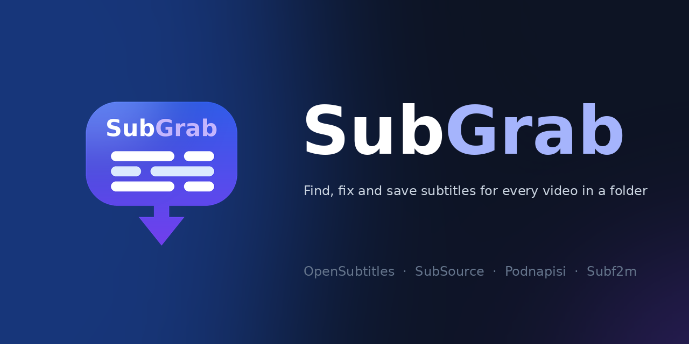
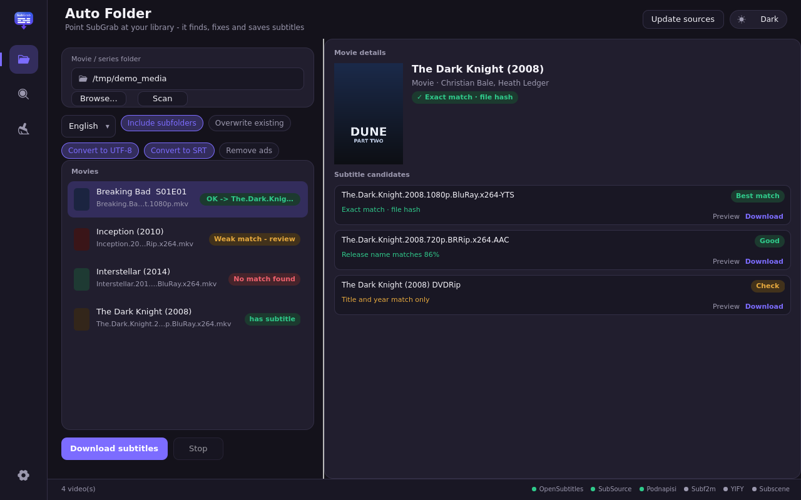
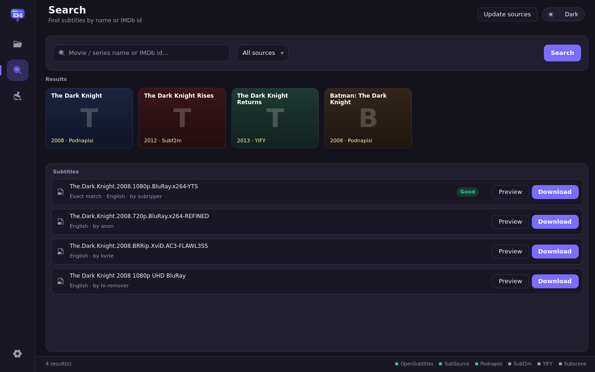
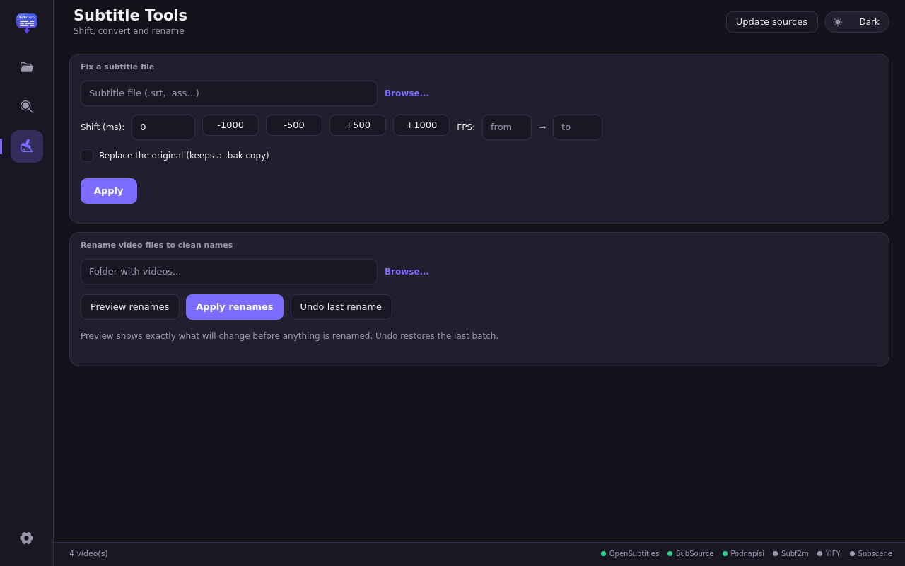

<p align="center"></p>

<p align="center">
  <a href="https://github.com/Megatro-nn/SubGrab/actions/workflows/ci.yml"></a>
  <a href="https://github.com/Megatro-nn/SubGrab/releases/latest"></a>
  
  
</p>
<p align="center">
  <a href="https://ko-fi.com/megatronazx"></a>
</p>

**SubGrab** is a free subtitle downloader for Windows, macOS and Linux. It finds, fixes and saves subtitles (SRT) for every
movie and TV series in a folder - or lets you search by name / IMDb id. It pulls from OpenSubtitles, SubSource and Subf2m,
converts subtitles to UTF-8 SRT, removes ads, and renames video files to clean names. Modern Qt Quick (QML / PySide6)
interface with dark and light themes, written in Python.

## Download
Grab the latest from **[Releases](../../releases/latest)**:

| File | Use it when |
|------|-------------|
| `SubGrab-Setup.exe` | You want a normal installer (Start menu, optional folder right-click menu, uninstaller). |
| `SubGrab-portable.zip` | No install: unzip, keep the `SubGrab` folder together, run `SubGrab.exe` inside it. |
| `SubGrab-macOS.dmg` / `SubGrab-macOS.zip` | macOS app (ad-hoc signed). |
| `SubGrab-x86_64.AppImage` / `SubGrab-linux.tar.gz` | Linux. |
| `SHA256SUMS*.txt` | Verify your download. |

### Opening the app the first time

The builds are not signed with a paid certificate, so your system may show a warning. The files are the same ones built in public by GitHub Actions; compare the SHA256 in `SHA256SUMS` with your download.

- **Windows**: if SmartScreen says "Windows protected your PC", click More info, then Run anyway. The installer and portable folder are normal unpacked builds (no UPX packing, full version info).
- **macOS** (including Sequoia): the app is ad-hoc signed. If macOS blocks it, open System Settings, then Privacy and Security, scroll down to the message about SubGrab and click Open Anyway, then confirm. On older versions, right-click the app and choose Open.
- **Linux**: use `SubGrab-x86_64.AppImage` (run `chmod +x` on it once, then double-click) or unpack `SubGrab-linux.tar.gz`, which includes a `.desktop` file.


> Windows SmartScreen may warn about unsigned builds until the app builds reputation - see [Code signing](#code-signing).

## Features
- **Auto Folder** - scans a movie / series folder (drag & drop works, or right-click a folder -> *Download subtitles with SubGrab*) and saves `Video.en.srt` next to each file. Optional folder watching.
- **Exact matches** - OpenSubtitles file-hash matching, plus release-name scoring (group, source, resolution,
  codec, edition). Weak matches are held back for review: preview them, or pick another candidate manually.
- **Understands real-world file names** - S01E02, 1x02, multi-episode (S01E01E02), anime absolute numbering
  ("Show - 03") and editions (Extended, Director's Cut). Fuzzy title matching tolerates typos and word order.
- **Rename files safely** - clean canonical names with preview and one-click undo (Subtitle Tools page).
- **Fixes on the way in** - UTF-8 conversion (Arabic / Persian code pages detected), ASS / VTT to SRT, optional ad &
  watermark removal and hearing-impaired tag removal, optional UTF-8 BOM for older TVs.
- **Official sources first** - OpenSubtitles.com and SubSource APIs, then optional fallbacks: Podnapisi,
  Subf2m, YIFY (movies), Subscene mirror. Unofficial scrapers are opt-in. If one fails, the next is tried;
  per-source status is shown and every source has a **Test** button.
- **Search page** - name or IMDb id, results with poster/details (needs Pillow), language filter, preview, download.
- **Subtitle Tools** - shift timing, frame-rate conversion (23.976 <-> 25 ...), re-encode, with `.bak` safety copy.
- **Two languages at once**, **RAR / 7z** via 7-Zip (bundled in release builds), **dark mode**, **Arabic UI (RTL)**,
  **update checker**, **portable mode**.

## Screenshots
<p align="center">
  <br>
  <em>Auto Folder: point at a folder, SubGrab matches and saves subtitles for every video.</em>
</p>
<p align="center">
  <br>
  <em>Search by name or IMDb id, with preview before you download.</em>
</p>
<p align="center">
  <br>
  <em>Subtitle Tools: shift timing, convert frame rate, rename videos with preview and undo.</em>
</p>

## Sources
Official APIs come first. Web-scraped sources are **off by default** - they break easily when the
sites change, may be blocked, and may conflict with those sites' terms; enable them in Settings > Sources
if you want them.

| Source | Key needed | Official | Notes |
|--------|-----------|----------|-------|
| OpenSubtitles | API key + free account | yes | Largest catalogue, file-hash matching. Free accounts have a daily download quota. |
| SubSource | Free API key | yes | Official API. |
| Podnapisi | no | no | Web scraping, experimental - the site changes often. |
| Subf2m | no | no | Web scraping, off by default; may be blocked by Cloudflare. |
| YIFY | no | no | Web scraping, off by default; movies only. |
| Subscene | no | no | Community mirror, off by default; the address may change (Settings > Advanced). |

The web-scraped sources depend on third-party page layouts. If one stops working, press **Test** in
*Settings > Sources*, attach `debug.log` (Settings > Advanced) to an issue, and it can usually be fixed quickly.

## Quick start (from source)
```bat
pip install PySide6        :: modern Qt interface (recommended)
python subgrab.py          :: or double-click run.bat
python -m unittest discover -s tests -v
```
Requires Python 3.9+. With PySide6 installed you get the modern Qt interface (crisper layout, native
posters, smoother tables); without it the app falls back to the built-in Tk interface, which needs no
dependencies at all. `pip install pillow` is optional (posters in the Tk interface).

## Build the exe and installer
```bat
packaging\build_windows.bat
```
Creates `dist\SubGrab.exe` and, if [Inno Setup 6](https://jrsoftware.org/isdl.php) is installed,
`installer\SubGrab-Setup.exe`. 7-Zip is bundled automatically when it is installed on the build machine.

### Publishing a release on GitHub
1. Replace `Megatro-nn` in this README and set `GITHUB_REPO = "your-name/SubGrab"` in `subgrab_core.py`
   (this turns on the in-app update checker).
2. Bump `VERSION` in `subgrab_core.py`, update `CHANGELOG.md`.
3. `git tag v1.0.0 && git push origin v1.0.0` - the **Release** workflow tests, builds, (optionally signs) and publishes
   the installer, exe, portable zip and checksums.

### Code signing
Unsigned executables trigger SmartScreen / antivirus warnings. To sign release builds, add repository secrets
`SIGN_PFX_BASE64` (your code-signing certificate, base64) and `SIGN_PFX_PASSWORD`; the workflow signs automatically.
Free options for open source: [SignPath Foundation](https://signpath.org/), or Azure Trusted Signing. Publishing
the SHA-256 checksums (done for you) and building with the latest PyInstaller also reduce false positives.

## Privacy & legal
No telemetry. SubGrab talks only to the sources you enable, IMDb's public suggestion endpoint (posters/details) and
GitHub (update check). API keys and the OpenSubtitles password are stored in the Windows Credential Manager (via the optional `keyring` package, bundled in release builds). Without `keyring` they fall back to `config.json` in plain text; existing plaintext entries are moved into the Credential Manager automatically on first run.
Subtitle sites have their own terms of use and rate limits - please respect them. SubGrab is not affiliated with any
of them.

## Contributing
See [CONTRIBUTING.md](CONTRIBUTING.md). Licensed under the [GNU GPL v3](LICENSE); bundled third-party software is
listed in [THIRD_PARTY_NOTICES.md](THIRD_PARTY_NOTICES.md).
